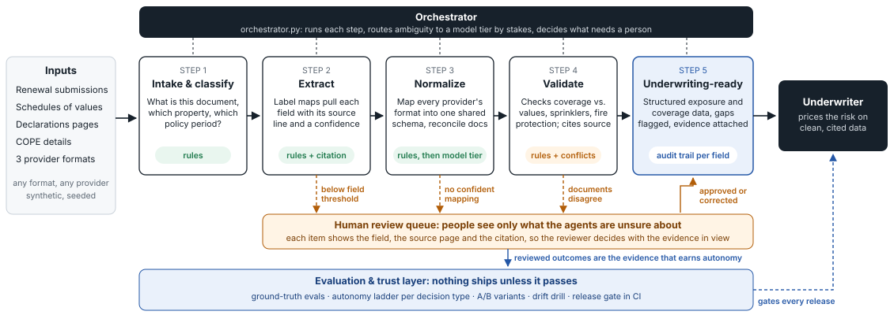

# staged-agent-pipeline

**Multi-step document agents that know when to stop and ask a person.**

A small, runnable reference implementation of how I design agentic workflows for regulated, high-stakes operations: break a long human process into specialist steps, use rules wherever a rule is enough, route only the ambiguous cases to a model tier chosen by the cost of being wrong, gate every field on confidence, and let each decision type *earn* autonomy from evidence and lose it automatically when quality drops.

The demo domain is commercial property renewals: turning a schedule of values, a COPE survey and a declarations page into an underwriting-ready record. The pattern is domain-agnostic. Swap the schema and the rules and it applies to patient intake, claims, KYC or any workflow where documents become decisions.



```bash
git clone https://github.com/Reddytheer/staged-agent-pipeline && cd staged-agent-pipeline
python -m staged_pipeline demo     # trace one packet step by step
python -m staged_pipeline eval     # A/B four architectures, write results/report.md
make check                         # eval + release gate (what CI runs)
```

No API key, no dependencies beyond the standard library (`pytest` for tests). Runs in under a second.

## What the evals show

300 held-out synthetic packets, 3,600 field decisions. Full table and method: [results/report.md](results/report.md), [docs/EVALS.md](docs/EVALS.md).

| | Staged + tiered routing *(this design)* | One long-context call *(baseline)* |
|---|---|---|
| **Wrong values no person saw** (false accepts) | **0.1%** | 4.2% |
| Fields accepted without review | 93.9% | 75.3% |
| Underwriting issues surfaced before review | 96% | 79% |
| Reviewer time per packet | 1.5 min | 3.2 min |
| Latency p50 / p95 | 0.08 s / 2.9 s | 9 s / 9 s |
| Model cost per packet | $0.003 | $0.060 |

Three more results that shaped the design:

- **Routing by stakes is nearly free quality.** Sending everything to the frontier model gave the same accuracy at 2.7x the model cost. Small models handle medium-stakes ambiguity; the frontier model is reserved for values and coverage.
- **Gates cost minutes and halve silent errors.** Turning gates off auto-accepts 98% of fields but triples false accepts. The gate is a product decision: 0.4 reviewer minutes per packet buys it.
- **Drift is caught, not discovered.** When the small model degrades by 35 points, a stale autonomy ladder lets false accepts rise 4x, concentrated in one decision type. Recalibrating demotes exactly that route (`occupancy+model`: sampled review → suggest) and brings false accepts back to baseline.

*All data is synthetic and model tiers are simulated with stated accuracy, latency and price assumptions. The numbers demonstrate the trade-offs between architectures; they are not benchmarks of any real model or production system. See [docs/EVALS.md](docs/EVALS.md#what-these-numbers-are-not).*

## Design choices and what they cost

| Choice | Why | Cost |
|---|---|---|
| Pipeline of specialists, not one prompt | Errors are caught at the step that made them; each step is testable alone | More orchestration and state |
| Rules before models | Fast, free, explainable; models only see what rules could not settle | Label and value maps to maintain (as config) |
| Model tier chosen by stakes | Frontier quality where errors are expensive, small-model cost elsewhere | Each tier needs its own evals |
| Confidence per field, not per document | Reviewers see the one uncertain field, not the whole packet | Thresholds tuned per stakes level |
| Disagreeing documents always go to a person | A model silently picking a side is the most dangerous failure | Some extra review |
| Never invent a value | Missing data becomes a request to the insured, not a guess | Follow-ups dominate reviewer time (see below) |
| Autonomy earned on a 95% lower bound, per decision route | Small samples and averages cannot buy autonomy | Model routes need a few hundred reviewed decisions to climb |
| Coverage terms capped at sampled review | What the customer is protected for always keeps a human sample | A permanent review floor |

The reasoning behind each is in [docs/DECISIONS.md](docs/DECISIONS.md).

## Time, scale and impact

Worked through in [docs/SCALE.md](docs/SCALE.md). At 10,000 packets a month:

- **Model spend** of about $29 a month for the staged design, against $600 for the single-call baseline.
- **Reviewer time** of about 250 hours, against roughly 3,300 hours to key the same packets by hand (assumed 20 minutes each). That is about 92% less manual work, with every remaining minute spent on a decision rather than on typing.
- **Where the human time goes** is the most useful finding: 75% of reviewer time is chasing values missing from every document, not correcting the AI. The next improvement is upstream (better intake requests), not a better model.
- **Onboarding a new data provider** is one row of label and value mappings in config, not a new parser.

## Repository map

```
staged_pipeline/
  schema.py        canonical fields, stakes and decision families
  synth.py         seeded synthetic packets: 3 provider formats, noise, ground truth
  steps.py         intake, extract (with citations), normalize, reconcile, validate
  models.py        ModelClient interface + simulated small/frontier tiers
  gates.py         confidence thresholds, autonomy ladder, Wilson lower bound
  orchestrator.py  staged pipeline and the monolith baseline behind one config
  evals.py         scoring, calibration, A/B variants, drift drill, release gate
tests/             behavioural tests of the promises the design makes
docs/              ARCHITECTURE · DECISIONS · EVALS · SCALE
results/           generated report and metrics
evals/baseline.json  the bar the release gate compares against
```

To use a real model, implement `ModelClient.resolve()` in [models.py](staged_pipeline/models.py). Nothing else changes, and the evals tell you whether the new model has earned the autonomy the old one had.

## Background

I was the lead architect and product owner of a production AI platform in commercial insurance that turns renewal and property data into underwriting-ready data. This repository is a clean-room reimplementation of the *pattern*, written to show how I think about agent design, evaluation and autonomy. It contains no code, data, prompts, schemas, customer information or metrics from that work. Every document, value and model here is synthetic.

Related: [autonomy-ladder](https://github.com/Reddytheer/autonomy-ladder) (earned autonomy in depth) · [judge-check](https://github.com/Reddytheer/judge-check) (when an LLM judge can grade alone).
